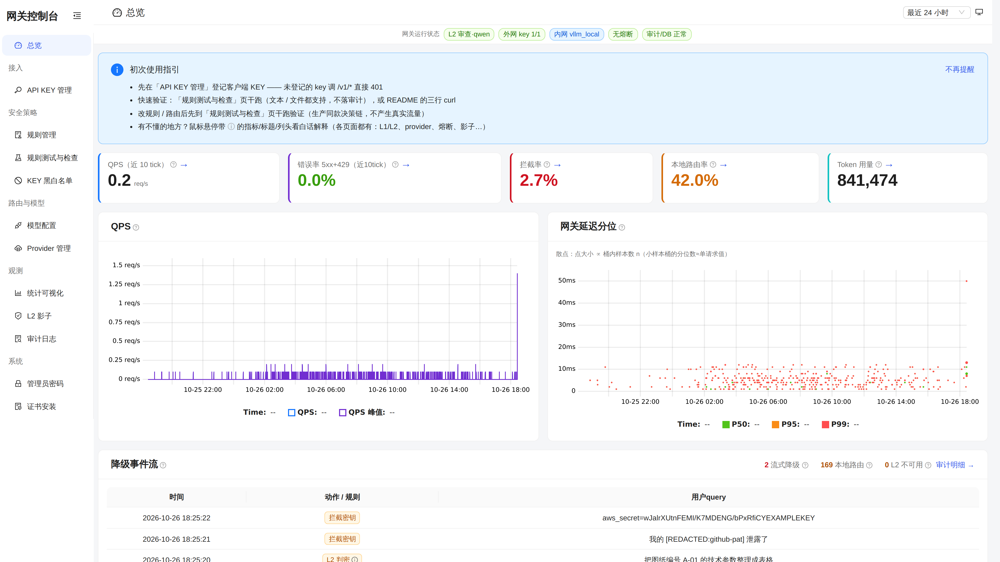
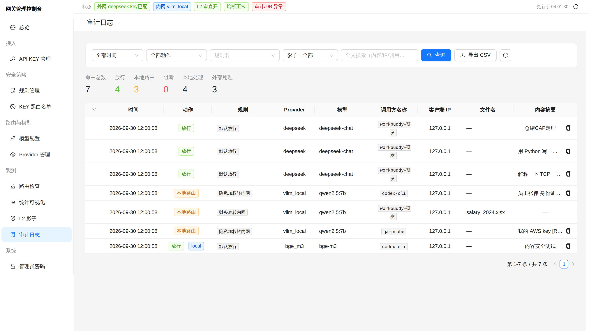
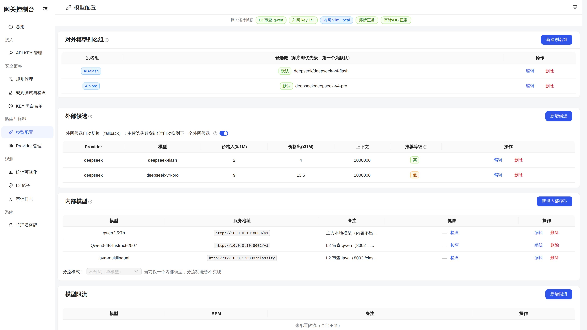
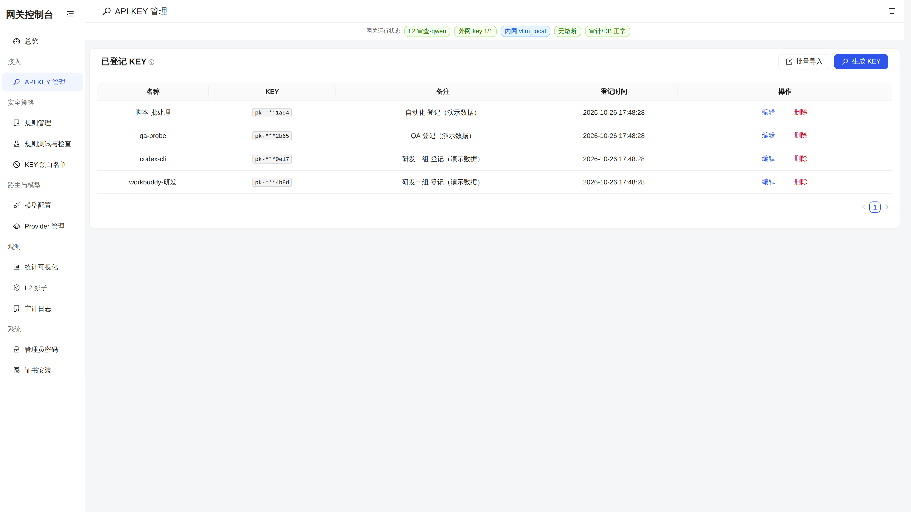
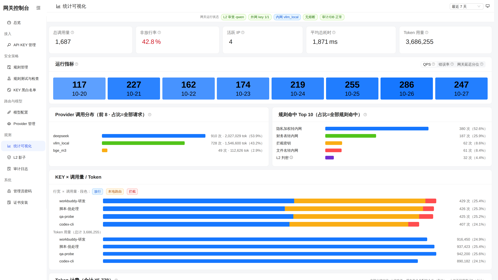
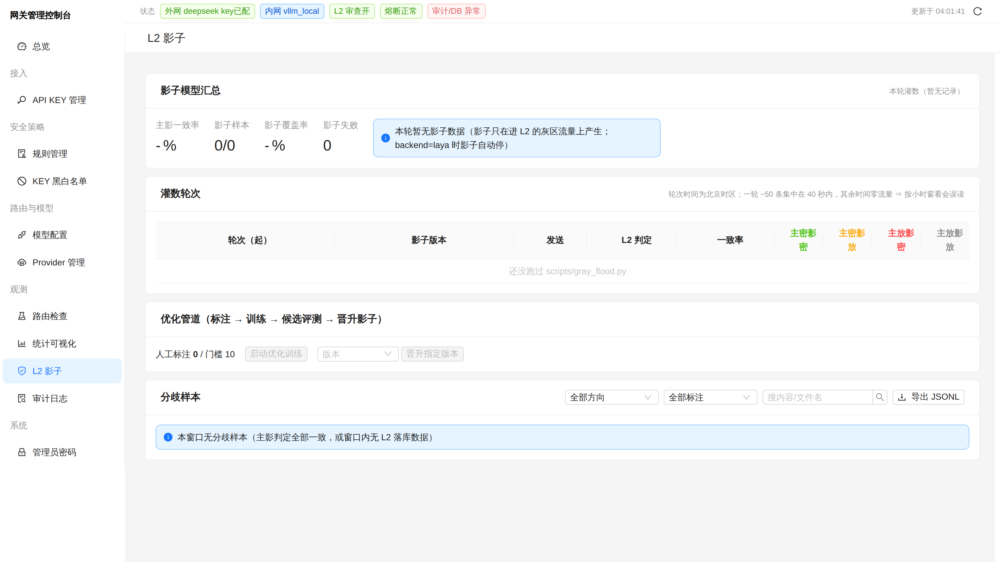

# Secure Gateway — L1 规则 + L2 小模型语义分级的内外网路由网关

> 大模型请求统一出口：机密内容（设计图纸、财务表格、PII）自动降级到内网模型，内容不出境；
> 普通请求放行外网 provider。L1 毫秒级规则先判，灰区/长文本再经 L2 小模型语义二次判定。

## 架构

```
客户端 (OpenAI SDK / Anthropic / codex / 管理台)
  -> Gateway (FastAPI, :8080)
      1. 鉴权      仅 admin 登记的 key 放行（Bearer / x-api-key，未登记 401）
      2. 文件预检  PDF/Excel/Word/图片(OCR) + magic 嗅探 + 表头/关键词/水印
      3. L1 规则   Regex(身份证/手机/AKIA/私钥) + 熵 + Luhn + 关键词三档 + PII 加权评分
      4. L2 小模型 qwen(OpenAI 协议) 或 laya(非自回归决策模型 /classify)，
                   灰区(risk ≥20，2026-09-23 起取消字数触发)进 L2；支持影子双跑（shadow_* 进审计）
      5. 策略引擎  policy.yaml 按 priority 命中即停（Pydantic 强校验）
      6. 路由      allow -> 外网（候选失败按 rank→价格自动切换）/ route_local -> 内网 / block
      7. 审计      Redis 热缓存 + MySQL 持久化（90 天，含 L2 判定 JSON），密钥自动脱敏
```

## 界面预览

| 管理台 · 总览 | 审计日志（含脱敏） |
|---|---|
|  |  |

| 模型配置（别名/候选/限流） | API KEY 管理 |
|---|---|
|  |  |

| 统计可视化 | L2 影子（双跑看板/提示词/重训管道） |
|---|---|
|  |  |

## 特性

- **文件维度预检**：xlsx 表名/表头/内容、PDF 文本层/水印、docx、图片 OCR（tesseract/paddle，
  缺引擎 fail-closed 转本地，绝不静默放行）；扩展名不可信，按 magic bytes 嗅探
- **对外模型名 `Auto-AB` / `local-model`**：`/v1/models` 只暴露这两个可发现的对话模型
  （`AI_GATEWAY_PUBLIC_MODELS` 白名单只收窄**可发现性**，不影响点名调用）；`Auto-AB` 是
  别名组，按本轮任务复杂度（1 轻 / 2 中 / 3 重）由 L2 小模型选头，会话级档位粘性只升不降；
  `local-model` 单候选直连本地（内容不出境）
- **L2 常开语义复核**：`AI_GATEWAY_L2_ALWAYS=true` 时所有 L1 放行请求都送 L2——risk=0 的
  语义泄密 L1 完全打不中（实测回放 120 条 risk=0 放行文本，4 条被 L2 判密），代价 +~230ms/请求
- **错误返回体统一**：成功看顶层 `model`（实际模型）+ `gateway.action/local/policy_rule`；
  失败看 `detail.type`（`key_blocked` / `rate_limited` / `quota_exceeded` / `model_not_chat` …），
  401 区分「缺 API key」与「key 未登记/无效」，黑名单 403 同时带 `detail` 与 `error`（SDK 兼容）
- **L2 双后端 + 影子双跑**：`AI_GATEWAY_L2_BACKEND=qwen|laya`；影子期主后端权威、
  laya 同流量并行打标，数据达标后一键切换；L2 提示词可管理台热改
- **L2 一键重训管道**：审计人工标注 ≥10 条 → `POST /admin/api/l2/retrain`
  （数据集构建 → GPU 微调 → 候选服务跑 battery/标注回归/历史分歧回归）→ 人工 promote
  切换影子权重；管理台 L2 页含影子趋势/分歧标注/导出；`scripts/l2_check.py` 一条命令体检候选版本
- **会话级机密粘性**：`X-Session-ID` 下文件/内联图命中机密后，同会话后续请求强制本地
- **协议桥**：OpenAI chat / Anthropic Messages / OpenAI Responses 互转，推理流（reasoning）透传
- **HTTPS + 内网 CA**：uvicorn 直结 TLS（自签内网 CA），`/ca.crt` `/ca.crl` 提供证书与吊销列表下载，
  客户端一次性装 CA 即免浏览器告警（见 `docs/https-cert-install.md`）
- **运维**：三态熔断（provider + prov::model 两级）、令牌桶限流（客户端级 + **模型级全局 RPM**：
  `model_policy.model_limits`，按最终路由到的模型计，别名/前缀重写不逃限，超限 429）、
  外发域名/路径白名单（`AI_GATEWAY_STRICT_EGRESS`）、24h 指标环 + Prometheus `/admin/metrics`
- **管理台**（`/admin`，内置前端）：key 登记/启停、规则 CRUD、provider 注册、对外模型别名组、
  外网候选（价格/上下文/rank + 失败自动切换）、内部模型登记（含健康检查）、模型限流、
  L2 配置/提示词、审计查询/CSV 导出、route-inspect 全链路干跑、熔断手动开关
- **文档**：`docs/user-manual.md`（用户接入）/ `docs/admin-manual.md`（管理台操作）

## 快速开始

```bash
# Docker 栈（redis + 网关；明细/审计库可指向外部 MySQL，不配则内存后端重启即丢）
cp .env.example .env        # 按需填 provider key / 内网地址 / AI_GATEWAY_ADMIN_PASSWORD / DATABASE_URL
docker compose up -d gateway redis

# 本地裸跑（mock 内网，零外发）
python3 -m venv .venv && .venv/bin/pip install -r requirements.txt
cp .env.example .env        # OLLAMA_MOCK=true，AI_GATEWAY_ADMIN_PASSWORD=<你的管理密码>
.venv/bin/python -m uvicorn src.gateway.main:app --host 0.0.0.0 --port 8080
```

已有内网模型时（`.env`）：

- `OLLAMA_BASE_URL` / `BGE_BASE_URL`：内网 chat / embedding vLLM 地址
- `SMALL_MODEL_URL`：L2 qwen 后端（OpenAI 协议，如 `:8002`）
- `AI_GATEWAY_L2_BACKEND=laya` + `AI_GATEWAY_L2_SHADOW_URL`：Laya 决策模型
  （`:8003 /classify`，需先跑 `scripts/laya_l2_server.py`，模板见 `scripts/laya-l2.service`）

首次使用：

1. 打开 `http://localhost:8080/admin`，用 `admin` + `AI_GATEWAY_ADMIN_PASSWORD` 登录（登录后建议改密）
2. 管理台「Key」页登记一个网关 key（**鉴权已收紧：未登记 key 一律 401，env dev key 不再放行**）
3. 登记后即可用该 key 调 `/v1/*`

## 验证

```bash
# 普通对话 -> allow 外网
curl -s http://localhost:8080/v1/chat/completions -H "Authorization: Bearer <你的key>" \
  -H "Content-Type: application/json" \
  -d '{"model":"gpt-4o-mini","messages":[{"role":"user","content":"总结CAP定理"}]}'
# -> "gateway":{"action":"allow","policy_rule":"default_allow"}

# 财务表格 -> route_local 内网（自备一张含 姓名/身份证号/工资 列的 xlsx）
curl -s http://localhost:8080/v1/files/check -H "Authorization: Bearer <你的key>" \
  -F "file=@/path/to/工资表.xlsx"
# -> "action":"route_local","policy_rule":"financial_local_only"

# 图纸 PDF -> route_local（tests/fixtures 里有现成样例）
curl -s http://localhost:8080/v1/files/check -H "Authorization: Bearer <你的key>" \
  -F "file=@tests/fixtures/drawing_confidential.pdf"
```

## 测试

```bash
.venv/bin/pip install pytest reportlab
.venv/bin/python -m pytest tests/ -q      # 基线见末行输出（live 联测默认 skip）
```

conftest 保证**零真实出境**：`OLLAMA_MOCK=true` + `SMALL_MODEL_ENABLED=false`
+ `routing._mock_enabled` 恒 True（外网 allow 链路也走产品 mock）。文件用例内存生成
（`tests/fixtures/` 提供 PDF 基线）；OCR 用例双路断言（有引擎走 PII 命中、缺引擎 fail-closed，
均不出境）。

## 目录

```
src/gateway/       网关主服务（main/policy/routing/inspection/file_inspector/small_model/admin_api/...）
  llms/            provider 线协议适配层（OpenAI-compat / Anthropic / Responses 桥）
tests/             pytest 套件（零出境隔离，fixtures/ 含图纸 PDF 与安全测试集 jsonl）
static/            管理台前端构建产物（/admin 直服，须与 web/admin 同提交）
web/admin/         管理台前端源码（React+antd+uPlot，npm run build 输出到 static/admin）
docs/              用户说明书 / 管理台操作手册 / 内网 CA 安装说明（docs/https-cert-install.md）
agents/            分层运维文档（部署 / vLLM 主机 / 策略路由 / env / 坑位记录）
scripts/           内网 vLLM/Laya systemd 模板、L2 数据集/微调/评估（OOD/留出）、
                   候选体检 l2_check.py、标注挖掘 mine_audit_labels.py、影子轮次 shadow_pulse.py、灰区灌数
policy.yaml        策略（priority 升序命中即停，Pydantic 强校验）
routing.yaml       provider 注册表（密钥只存 env 变量名，${VAR:default} 展开）
model_policy.yaml  外网候选/内网模型/模型限流(model_limits)/负载均衡
l2_overrides.yaml  L2 运行时覆盖
docker-compose.yml / Dockerfile
.env.example       配置模板（.env 不入库）
```

## 策略（policy.yaml，priority 升序，2026-10 现值）

| priority | 规则 | 行为 |
|---|---|---|
| 3 | block_secrets | AKIA/PEM私钥/ghp_/sk-ant/sk-32hex/aws_secret -> block（压过全部 route_local；`on_block: fallback_local` 时降本地） |
| 5 | tainted_file_ref | 正文提及已判密文件名 -> 本地 |
| 10 | financial_local_only | 表头/表名/文件名财务关键词 -> 本地 |
| 12 | session_route_local | 会话已判密 -> 本地 |
| 13 | unparsed_binary_route_local | 解析不出的二进制 -> 本地（fail-closed） |
| 20 | pii_weighted_route_local | PII 加权评分 >= 60 -> 本地 |
| 30 | ocr_empty_image_route_local | OCR 空结果图片 -> 本地（fail-closed） |
| 40 | drawing_local_only | 扩展名/水印/内容含"机密/图纸" -> 本地 |
| 100 | default_allow | 放行外网 |

## 安全基线

- `.env` 不入库（`.gitignore` 已含）；`routing.yaml` 只存 `api_key_env` 变量名
- 生产建议：`AI_GATEWAY_UPSTREAM_KEY_MODE=gateway_only`（外发凭据只走网关侧）、
  `AI_GATEWAY_STRICT_EGRESS=true`（兜底路径白名单外 403）、`AI_GATEWAY_ADMIN_IP_ALLOWLIST` 收紧
- 审计写前自动脱敏密钥（AKIA/PEM/GitHub PAT/sk-ant-/JWT/Bearer）；PII 留原文供追责
- 客户端接入只需改 `base_url` + `api_key`，SDK 代码不动；Claude Code / Codex CLI 接入见
  `agents/policy-routing.md`
